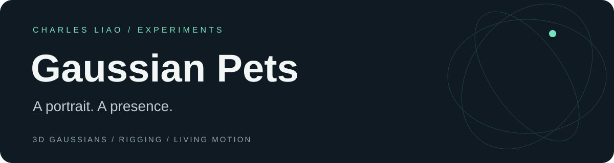
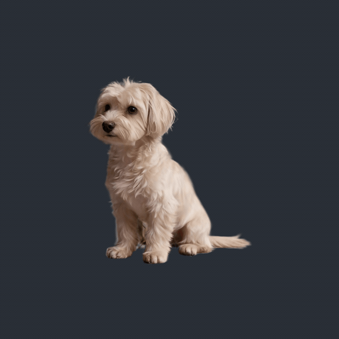
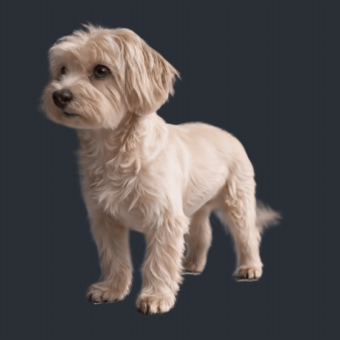

<div align="center">



**从一张宠物照片出发，让三维形象拥有生命感。**

3D Gaussian Splatting · Rigging · Living Motion

[动态展示](#动态展示) · [当前进展](#当前进展) · [动画研究](docs/animation-notes.md) · [交流](https://github.com/CharlesJunyuLiao/gaussian-pets/issues)

</div>

## Gaussian Pets

我在做一件很具体的事：把宠物照片中的神态与毛发质感，带进一个可以呼吸、眨眼、回应人的三维角色里。

目前，我已经打通从正面宠物照片出发制作静态 3D 高斯形象、骨架绑定与呼吸动画的实验链路。接下来，我关注的是更自然的眼部表现，以及大幅动作下的形体与毛发稳定性。

## 动态展示

<table>
<tr><th align="left">01 / Seated companion</th><th align="left">02 / Standing companion</th></tr>
<tr><td></td><td></td></tr>
<tr><td>坐姿 · 呼吸与轻微头部起伏</td><td>站姿 · 胸腹呼吸</td></tr>
</table>

以上均为实际高斯模型的渲染帧导出。两个形象是独立资产，展示不代表已完成坐姿与站姿之间的动作转换。GIF 为轻量预览，可在 `media/` 查看 MP4。

## 当前进展

| 能力 | 状态 |
| :--- | :--- |
| 从正面宠物照片出发制作静态高斯形象 | 已在当前宠物样例中实现 |
| 骨架／代理绑定与动画播放 | 已完成实验链路 |
| 呼吸与小幅待机运动 | 已实现，见上方实际演示 |
| 眨眼 | 已有实验版本，眼睑遮挡与闭眼外观仍在优化 |
| 坐下、站起等大幅动作 | 研究中，尚未达到满意效果 |
| 跨品种、跨物种自动绑定 | 目标方向，尚未完成通用验证 |

## 我正在探索

**让动作成立，也让外观留住。** 对毛发丰富的高斯角色，骨骼能移动只是开始；眼周覆盖、关节折叠、透明边缘与体积保持，需要一起工作。

我正在研究三个方向：局部眼睑表达、适合宠物解剖结构的绑定与权重，以及较大形变下的高斯协方差与外观稳定性。相关观察记录在 [Animation Notes](docs/animation-notes.md)。

如果你也在研究 animatable Gaussians、角色绑定或数字宠物，欢迎在 [Issues](https://github.com/CharlesJunyuLiao/gaussian-pets/issues) 交流你的观察与实验。

## 仓库内容

这是项目的公开展示与动画研究仓库，包含展示页源码、实际渲染演示和进展记录。资产生成端与完整内部研发流程不包含在本次发布中；本仓库不是完整生成工具包。

本地查看展示页（Node.js 18+，无需安装依赖）：

```sh
node serve.cjs
```

打开 `http://127.0.0.1:8800/`。网页播放已导出的模型动画，不提供在线生成服务。

## 致谢与许可

动画实验使用了 [KIRI 3DGS Render for Blender](https://github.com/Kiri-Innovation/3dgs-render-blender-addon) 的代理绑定与形变烘焙能力，实际高斯预览基于 [PlayCanvas](https://github.com/playcanvas/engine)。感谢这些项目和 3DGS 研究社区。

本仓库独立编写的展示页代码采用 MIT 许可；演示媒体的使用范围见 [MEDIA-LICENSE](MEDIA-LICENSE.md)。上游算法与工具归各自作者所有，详见 [CREDITS](CREDITS.md)。

---

Built by **[Charles Liao](https://github.com/CharlesJunyuLiao)** · Shenzhen · 2026
