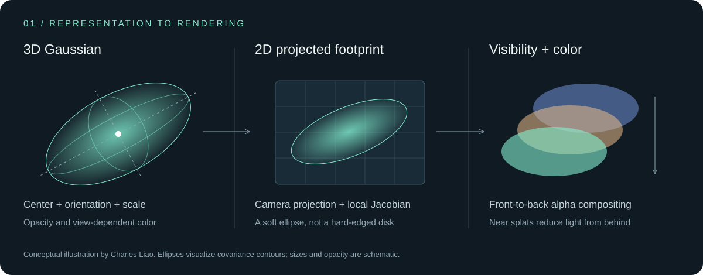
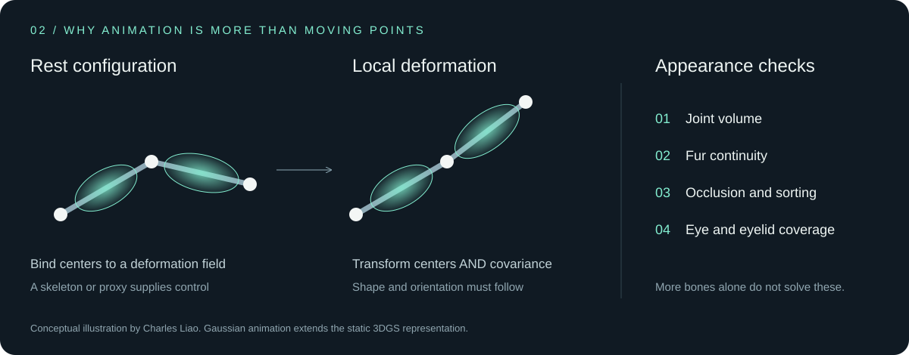

## Understanding 3D Gaussian Splatting

My background in physics makes me particularly interested in the geometry behind these images. Here is my illustrated guide to the public foundations of 3DGS, followed by the mathematics that matters when a static character starts to move.

> **Scope:** This is an explanation of established rendering theory, not a claim that I invented 3D Gaussian Splatting. The original method is due to Kerbl et al. (2023). The animation discussion describes general deformation principles beyond the original static method.

### 1. A scene made of soft, oriented primitives

A Gaussian is not a tiny solid ball. It is a smooth spatial influence function. A scene is represented by many overlapping primitives, each with a center, an anisotropic covariance, opacity, and color coefficients.

| Quantity | Symbol | Geometric meaning |
| :--- | :--- | :--- |
| Center | $\boldsymbol{\mu}_i \in \mathbb{R}^3$ | Where the primitive is located |
| Covariance | $\boldsymbol{\Sigma}_i \in \mathbb{R}^{3\times3}$ | Its orientation and extent along different directions |
| Opacity | $o_i\in(0,1)$ | Its maximum contribution to coverage |
| Appearance | $\mathbf{c}_i(\mathbf{d})$ | RGB color, potentially dependent on viewing direction |

The spatial kernel is

$$
G_i(\mathbf{x})=\exp\!\left[-\frac{1}{2}(\mathbf{x}-\boldsymbol{\mu}_i)^T\boldsymbol{\Sigma}_i^{-1}(\mathbf{x}-\boldsymbol{\mu}_i)\right].
$$

This is an **unnormalized kernel**, not a probability density integrating to one. The equal-value contours are ellipsoids. Long, thin ellipsoids can represent directional detail, but poorly constrained ones can also produce stretched or floating artifacts.

<strong>Read the mathematical details: shape, projection, color, and compositing</strong>

### 2. Parameterizing a valid covariance

Rather than optimizing an arbitrary matrix, the covariance can be built from a rotation and positive axis scales:

$$
\boldsymbol{\Sigma}=\mathbf{R}(\mathbf{q})\,\mathbf{S}\mathbf{S}^{T}\,\mathbf{R}(\mathbf{q})^{T},\qquad
\mathbf{S}=\operatorname{diag}(s_x,s_y,s_z).
$$

Here $\mathbf{q}$ is a normalized quaternion. Positive scales can be obtained as $s_k=\exp(\ell_k)$, while opacity can be parameterized as $o=\operatorname{sigmoid}(a)$. With strictly positive scales, this construction gives a symmetric positive-definite covariance.

The eigenvectors describe the ellipsoid's principal axes; the square roots of the eigenvalues give its standard deviations along those axes. Covariance is therefore part of the geometry, not merely a blur setting.

### 3. Projecting a 3D Gaussian onto the image

Let the world-to-camera transform have rotation $\mathbf{R}_c$ and translation $\mathbf{t}_c$. The center in camera coordinates is

$$
\mathbf{m}_c=\mathbf{R}_c\boldsymbol{\mu}+\mathbf{t}_c=(x_c,y_c,z_c)^T.
$$

For a pinhole camera,

$$
\pi(\mathbf{m}_c)=\begin{bmatrix}f_x x_c/z_c+c_x\\f_y y_c/z_c+c_y\end{bmatrix},\qquad
\mathbf{J}=\begin{bmatrix}f_x/z_c&0&-f_xx_c/z_c^2\\0&f_y/z_c&-f_yy_c/z_c^2\end{bmatrix}.
$$

A first-order approximation gives the two-dimensional covariance:

$$
\boldsymbol{\Sigma}_{\mathrm{2D}}\approx\mathbf{J}\mathbf{R}_c\boldsymbol{\Sigma}\mathbf{R}_c^T\mathbf{J}^T.
$$

Perspective is nonlinear, so this is a **local approximation** evaluated at the Gaussian center. Renderers also use numerical and pixel-footprint filtering safeguards. This equation describes the geometric core, not every implementation detail.

### 4. View-dependent color

The original method uses spherical harmonics (SH) to model color as a function of viewing direction:

$$
\mathbf{c}_i(\mathbf{d})=\sum_{\ell=0}^{L}\sum_{m=-\ell}^{\ell}\mathbf{k}_{i\ell m}Y_{\ell}^{m}(\mathbf{d}).
$$

Each coefficient $\mathbf{k}_{i\ell m}$ has RGB components. Degree zero represents direction-independent color; higher degrees can capture changes with viewing angle. This is a compact appearance model, not a full physically based material or a guarantee of correct relighting. Color offsets and clamping depend on the implementation.

### 5. Alpha compositing: why order matters

For pixel position $\mathbf{p}$, a projected Gaussian contributes

$$
\alpha_i(\mathbf{p})=o_i\exp\!\left[-\frac{1}{2}(\mathbf{p}-\boldsymbol{\mu}_{i,\mathrm{2D}})^T\boldsymbol{\Sigma}_{i,\mathrm{2D}}^{-1}(\mathbf{p}-\boldsymbol{\mu}_{i,\mathrm{2D}})\right].
$$

With splats ordered front to back, the transmittance before splat $i$ is

$$
T_i(\mathbf{p})=\prod_{j<i}\left(1-\alpha_j(\mathbf{p})\right).
$$

The final color, including a background, is

$$
\mathbf{C}(\mathbf{p})=\sum_{i=1}^{N}T_i(\mathbf{p})\alpha_i(\mathbf{p})\mathbf{c}_i(\mathbf{d})+\left[\prod_{i=1}^{N}(1-\alpha_i(\mathbf{p}))\right]\mathbf{C}_{\mathrm{bg}}.
$$

For two splats, this becomes $\mathbf{C}=\alpha_1\mathbf{c}_1+(1-\alpha_1)\alpha_2\mathbf{c}_2+(1-\alpha_1)(1-\alpha_2)\mathbf{C}_{\mathrm{bg}}$. Reversing their order generally changes the result. The original tiled renderer uses an efficient depth-ordering approximation; transparent overlap is not equivalent to an opaque mesh depth test.

### 6. How the representation is learned

In standard 3DGS, rendered images are compared with calibrated training views. Optimization adjusts centers, shape, opacity, and appearance. The original photometric objective combines an image-space L1 term with a structural-similarity term:

$$
\mathcal{L}=(1-\lambda)\mathcal{L}_1+\lambda\mathcal{L}_{\mathrm{D\text{-}SSIM}}.
$$

Adaptive density control clones or splits selected Gaussians and prunes others according to the method's criteria. More primitives can increase capacity, but **point count alone does not determine quality**. Observation coverage, camera accuracy, consistency, regularization, and rendering all matter. Increasing capacity cannot reliably recover details that were never observed.

The speed comes from projecting explicit primitives, binning them into screen tiles, sorting, and compositing their contributions efficiently on the GPU. Actual speed depends on resolution, overlap, primitive count, implementation, and hardware.

### 7. From static appearance to an animated character

Moving only the centers leaves each Gaussian's shape and orientation behind. For an affine deformation $\mathbf{x}'=\mathbf{A}\mathbf{x}+\mathbf{b}$, the corresponding Gaussian transformation is

$$
\boldsymbol{\mu}'=\mathbf{A}\boldsymbol{\mu}+\mathbf{b},\qquad
\boldsymbol{\Sigma}'=\mathbf{A}\boldsymbol{\Sigma}\mathbf{A}^T.
$$

This is exact for an affine transform of a Gaussian distribution. For a nonlinear deformation field $f$, a local approximation is

$$
\boldsymbol{\mu}'=f(\boldsymbol{\mu}),\qquad
\boldsymbol{\Sigma}'\approx\mathbf{J}_f(\boldsymbol{\mu})\boldsymbol{\Sigma}\mathbf{J}_f(\boldsymbol{\mu})^T.
$$

These equations transport geometry. They do **not**, by themselves, determine how opacity, SH appearance, or visibility should behave under deformation, nor do they reconstruct previously hidden surfaces.

<strong>Rigging details: skinning weights, volume, and missing surfaces</strong>

For linear blend skinning, a center may be transformed using bone matrices $\mathbf{M}_b$ that map the bind pose into the posed configuration:

$$
\widetilde{\boldsymbol{\mu}}'_i=\sum_b w_{ib}\mathbf{M}_b\widetilde{\boldsymbol{\mu}}_i,\qquad w_{ib}\geq0,\qquad\sum_b w_{ib}=1.
$$

The tilde denotes homogeneous coordinates. If weights are treated as locally constant around a Gaussian and $\mathbf{A}_b$ is the linear part of $\mathbf{M}_b$, then $\mathbf{A}_i=\sum_b w_{ib}\mathbf{A}_b$ gives one local covariance-transport approximation. A continuous field with spatially varying weights has additional weight-gradient terms in its Jacobian.

Blending rotations linearly can shrink volumes near joints. Alternative skinning methods, deformation graphs, learned fields, or proxy-based approaches may help, but none automatically resolves poor joint placement, inaccurate weights, or missing surface coverage.

For blinking, an eyeball becoming smaller is not a substitute for an eyelid covering it. For sitting and standing, a valid skeleton does not guarantee stable fur, pelvis geometry, or newly exposed surfaces. This is why I evaluate motion, geometry, and appearance together.

### 8. Questions I use to evaluate a result

| Question | Why it matters |
| :--- | :--- |
| Does detail remain stable across viewpoints? | A convincing front view can hide geometry and coverage problems. |
| Do joints preserve volume while bending? | Correctly moving bones can still produce poor surface deformation. |
| Do covariance, depth ordering, and appearance follow the motion? | Center motion alone is insufficient for stable splat rendering. |
| Does a blink cover the eye naturally? | Compression and true occlusion are different mechanisms. |
| Does the method generalize beyond the current examples? | A successful demonstration is not proof of automatic cross-species performance. |

### References

1. **Kerbl, B., Kopanas, G., Leimkühler, T., and Drettakis, G. (2023).** *3D Gaussian Splatting for Real-Time Radiance Field Rendering.* ACM Transactions on Graphics, 42(4). [Project and paper](https://repo-sam.inria.fr/fungraph/3d-gaussian-splatting/) · [Official implementation](https://github.com/graphdeco-inria/gaussian-splatting).
2. **Zwicker, M., Pfister, H., van Baar, J., and Gross, M. (2002).** *EWA Splatting.* IEEE Transactions on Visualization and Computer Graphics, 8(3), 223–238. [DOI](https://doi.org/10.1109/TVCG.2002.1021576). Background on elliptical splatting and reconstruction filtering.

The diagrams are my own explanatory schematics. Equations are presented as a guide to established theory; they do not disclose the private asset-generation system or imply that the current pet demos implement every method discussed above.
